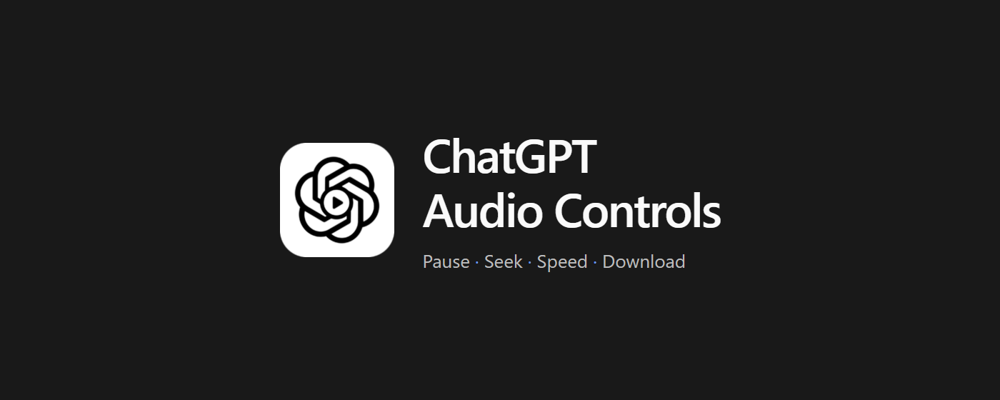
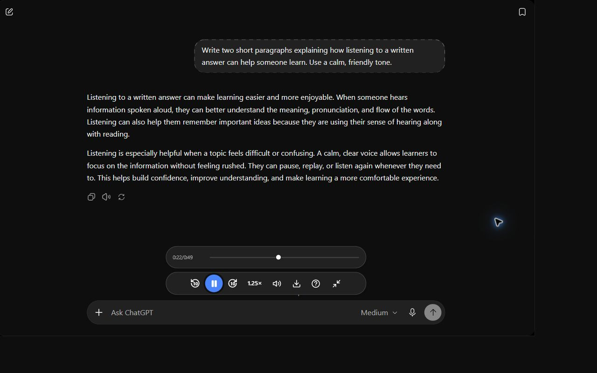
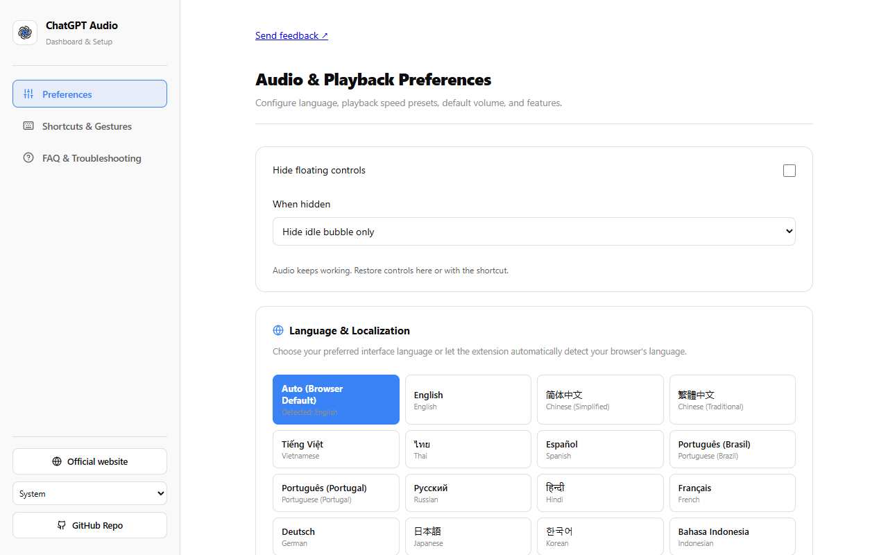

<div align="center">

# 🎙️ ChatGPT Audio Controls & Read Aloud

**Playback controls that make ChatGPT Read Aloud usable.**<br />
*Play, pause, seek, change speed, adjust volume, download audio, and keep your place while listening.*

<p align="center">
  <a href="https://chromewebstore.google.com/detail/aifalimlfgiepmbejcemcofninobaiea/">
    
  </a>
  &nbsp;&nbsp;&nbsp;&nbsp;
  <a href="https://microsoftedge.microsoft.com/addons/detail/chatgpt-audio-controls-/cmhbacgmcgiolpidfjcpefkhbbeamemf">
    
  </a>
</p>

[](CHANGELOG.md)
[](https://chromewebstore.google.com/detail/aifalimlfgiepmbejcemcofninobaiea/)
[](https://microsoftedge.microsoft.com/addons/detail/chatgpt-audio-controls-/cmhbacgmcgiolpidfjcpefkhbbeamemf)
[](userscript/chatgpt-audio-controls.user.js)
[](LICENSE)
[](https://agent-ready.dev)

[Why I Created This](#why-i-created-this) • [Features](#features) • [Languages](#-multi-language--internationalization-i18n) • [Installation](#installation) • [Tampermonkey Guide](#tampermonkey-guide-no-extension-required) • [Shortcuts](#keyboard-shortcuts--gestures) • [FAQ](#faq) • [Privacy](#privacy-policy)

<br />



</div>

---

## 🎧 Why I Created This

In the AI age, a simple question can turn into a kilometre-long answer before you have finished your coffee. ChatGPT's native Read Aloud button starts playback; longer answers benefit from pause, resume, and seeking controls.

Pause halfway through because a call comes in? Suddenly you are choosing between real life and the remaining half of an AI-generated epic. That felt needlessly frustrating.

This extension adds play/pause, seeking, speed, volume, and download controls right where the conversation happens.

> ChatGPT Audio Controls is an independent project and is not affiliated with, endorsed by, or sponsored by OpenAI. ChatGPT is a trademark of OpenAI.

---

## ✨ Features

<div align="center">
  
</div>

### 🎛️ Integrated Floating Player
- **Sleek Seeker & Scrubbing**: Precise 2px→4px progress bar with live timers (`0:00 / 0:00`).
- **Hold to Accelerate**: Hold down the ◀10s or 10s▶ buttons to smoothly scrub through long audio with dynamic acceleration (up to 50× seek rate).
- **Speed Presets**: Instant switching between `0.5×`, `0.75×`, `1.0×`, `1.25×`, `1.5×`, `1.75×`, `2.0×`, `2.5×`, and `3.0×`.
- **Hover-Scroll Volume**: Hover over the speaker icon and scroll your mouse wheel to adjust volume effortlessly in 5% increments.
- **One-Click Audio Download**: Save the active Read Aloud stream directly to your computer in the source format exposed by ChatGPT.
- **Responsive Layout**: Keeps the player usable on narrow laptop screens.
- **Floating Mini Toggle**: When no audio is playing, a neat floating logo button stays docked on the right. Click it anytime to expand the player!

### ⚛️ Extension Popup & Dashboard

<div align="center">
  
</div>

- **Popup**: Speed presets, volume, shortcuts, and smooth scrubbing. Help sits beside Dashboard; Send feedback is in About.
- **Settings Dashboard**: Customize default speed, volume, and seek step; view shortcuts and troubleshooting guidance.
- **System, Light, or Dark** appearance for the popup, settings dashboard, and feedback form. System follows your device preference; your choice is remembered.

### 🌐 Multi-Language & Internationalization (i18n)
- **Automatic Browser Language Detection**: Automatically adapts to your browser language out of the box.
- **Customizable in Settings**: Switch your preferred interface language anytime from the Dashboard.
- **Supported interface languages in the v1.4.0 candidate (33)**:
  - **Arabic** — العربية (`ar`)
  - **Bengali** — বাংলা (`bn`)
  - **Catalan** — Català (`ca`)
  - **Chinese (Simplified)** — 简体中文 (`zh-CN`)
  - **Chinese (Traditional)** — 繁體中文 (`zh-TW`)
  - **Czech** — Čeština (`cs`)
  - **English** — English (`en`)
  - **French** — Français (`fr`)
  - **German** — Deutsch (`de`)
  - **Greek** — Ελληνικά (`el`)
  - **Hebrew** — עברית (`he`)
  - **Hindi** — हिन्दी (`hi`)
  - **Hungarian** — Magyar (`hu`)
  - **Indonesian** — Bahasa Indonesia (`id`)
  - **Italian** — Italiano (`it`)
  - **Japanese** — 日本語 (`ja`)
  - **Korean** — 한국어 (`ko`)
  - **Marathi** — मराठी (`mr`)
  - **Norwegian Bokmål** — Norsk bokmål (`nb`)
  - **Persian** — فارسی (`fa`)
  - **Polish** — Polski (`pl`)
  - **Portuguese (Brazil)** — Português (Brasil) (`pt-BR`)
  - **Portuguese (Portugal)** — Português (Portugal) (`pt-PT`)
  - **Romanian** — Română (`ro`)
  - **Russian** — Русский (`ru`)
  - **Spanish** — Español (`es`)
  - **Swedish** — Svenska (`sv`)
  - **Tamil** — தமிழ் (`ta`)
  - **Telugu** — తెలుగు (`te`)
  - **Thai** — ไทย (`th`)
  - **Turkish** — Türkçe (`tr`)
  - **Ukrainian** — Українська (`uk`)
  - **Vietnamese** — Tiếng Việt (`vi`)

---

## 🚀 Installation

### Option 1: Official Browser Stores (Recommended)

Get automatic updates and seamless one-click installation from your browser's official store:

| Store | Supported Browsers | Install Badge | Direct Link |
| :--- | :--- | :---: | :--- |
| **Chrome Web Store** | Google Chrome, Brave, Arc, Opera, Vivaldi | <a href="https://chromewebstore.google.com/detail/aifalimlfgiepmbejcemcofninobaiea/"></a> | [Install from Chrome Web Store](https://chromewebstore.google.com/detail/aifalimlfgiepmbejcemcofninobaiea/) |
| **Microsoft Edge Add-ons** | Microsoft Edge | <a href="https://microsoftedge.microsoft.com/addons/detail/chatgpt-audio-controls-/cmhbacgmcgiolpidfjcpefkhbbeamemf"></a> | [Install from Microsoft Edge Add-ons](https://microsoftedge.microsoft.com/addons/detail/chatgpt-audio-controls-/cmhbacgmcgiolpidfjcpefkhbbeamemf) |

---

### Option 2: Manual Installation (Developer Mode / Unpacked)

#### Method A: Load from Source
1. Clone or download this repository:
   ```bash
   git clone https://github.com/infoxica/chatgpt-audio-controls.git
   cd chatgpt-audio-controls
   ```
2. Install dependencies and build with Bun:
   ```bash
   bun install
   bun run build
   ```
3. Open your browser extension settings:
   - **Chrome**: `chrome://extensions/`
   - **Brave**: `brave://extensions/`
   - **Edge**: `edge://extensions/`
4. Turn on **Developer mode** (toggle in the top-right corner).
5. Click **Load unpacked** and select the `dist/` directory.
6. Open [chatgpt.com](https://chatgpt.com) and enjoy full audio control!

#### Method B: Install from Release ZIP
1. Download the latest `chatgpt-audio-controls-v*.zip` from [Releases](https://github.com/infoxica/chatgpt-audio-controls/releases).
2. Unzip to a folder on your computer.
3. In `chrome://extensions/`, enable **Developer mode**, click **Load unpacked**, and select the unzipped folder.

---

## 🐒 Tampermonkey Guide (No Extension Required)

If you prefer using a userscript manager (on Firefox, Chrome, Safari, or Edge):

1. Install [Tampermonkey](https://www.tampermonkey.net/) or [Violentmonkey](https://violentmonkey.github.io/).
2. Click the link below to open the raw userscript:
   👉 **[Install ChatGPT Audio Controls Userscript](https://raw.githubusercontent.com/infoxica/chatgpt-audio-controls/master/userscript/chatgpt-audio-controls.user.js)**
3. Tampermonkey will open and ask you to click **Install**.
4. Visit [https://chatgpt.com](https://chatgpt.com) — the player is fully active!

> [!TIP]
> **Automatic Updates**: The userscript includes `@updateURL` and `@downloadURL` pointing to GitHub. Tampermonkey will automatically check for updates and keep your script current.

---

## ⌨️ Keyboard Shortcuts & Gestures

| Shortcut | Action | Description |
| :--- | :--- | :--- |
| <kbd>Space</kbd> / <kbd>K</kbd> | **Play / Pause** | Toggle speech playback (Alt + P remains supported) |
| <kbd>Alt</kbd> + <kbd>←</kbd> | **Skip Backward** | Jump back 10 seconds (Hold to scrub) |
| <kbd>Alt</kbd> + <kbd>→</kbd> | **Skip Forward** | Jump forward 10 seconds (Hold to scrub) |
| <kbd>Shift</kbd> + <kbd>&lt;</kbd> | **Slower Speed** | Step down to the previous speed preset |
| <kbd>Shift</kbd> + <kbd>&gt;</kbd> | **Faster Speed** | Step up to the next speed preset |
| **Scroll on 🔈** | **Volume Control** | Hover over volume icon & scroll wheel |
| **Hold ◀10 / 10▶** | **Smooth Scrub** | Hold down skip buttons to fast-forward / rewind |

*(Shortcuts are disabled automatically when typing in prompt inputs.)*

---

## ❓ FAQ

<details>
<summary><strong>How do I download the speech audio?</strong></summary>
When Read Aloud is playing, click the download icon (📥) on the right rail. The audio stream is immediately saved to your computer as an audio file.
</details>

<details>
<summary><strong>What happens when no audio is playing?</strong></summary>
The player collapses into a small circular expand button. Click it to open the player, or start ChatGPT's native Read Aloud to open it automatically.
</details>

<details>
<summary><strong>Will this work on compact laptop screens?</strong></summary>
The player measures available space. Original desktop placement uses two separate capsules beside or above the composer. Below 768 CSS pixels, a shared two-row dock joins the composer; secondary controls open from its compact controls button. If space is insufficient, an expandable circle stays inside the visible viewport without replacing your saved layout.
</details>

<details>
<summary><strong>Why didn't icons render in previous Tampermonkey scripts?</strong></summary>
Previous scripts tried loading external web fonts which browsers blocked. This version uses 100% self-contained inline SVGs, so all icons render instantly with zero network calls.
</details>

---

## 🔒 Privacy Policy

Playback, retained audio, seeking, and downloads run locally in your browser. The extension has no analytics or automatic diagnostic uploads. Browser sync may synchronize preferences.

Your feedback is optional and private, even after uninstalling. No name or email is required. Please don’t include personal details or conversations. Use **Send feedback** in About or the settings dashboard; the same form opens after uninstalling. Only submitting the form saves feedback. Opening, skipping, or closing it saves nothing. See [PRIVACY.md](PRIVACY.md) for full details.

---

## v1.4.0 — Native player and magnetic docking (release candidate)

Drag the circular collapse/expand control to reveal fitting destinations: original placement, four corner L layouts, two vertical side-center layouts, or the composer dock. Targets match the real controls and attract the dragged player within 24 CSS pixels. A pill's subtle grip swaps it with the other slot in the current layout.

The composer dock shares the input's width and surface, with one desktop row or two mobile rows. Collapse slides it away, leaving an expand circle on the right for LTR languages or left for RTL. Placement, pill order and reset are also keyboard-accessible in settings. Versioned desktop/mobile profiles stay on this device; compatible earlier preferences migrate automatically. Drops settle in about 220ms, reset takes 280ms, and collapse/expand takes 200ms. Reduced-motion preferences remove animated travel and magnetic movement.

This candidate supports 33 interface languages, including Polish, Hungarian, Swedish, Czech, Ukrainian, Catalan, Greek, Romanian and Norwegian Bokmål. Auto stays first; language choices follow English-name alphabetical order. Arabic, Persian and Hebrew use RTL. Audio languages and voices still come from ChatGPT. New translations await native-speaker review.

Open settings sections, four support actions, individual shortcut-edit guidance and a five-second optional download-ready toast complement the refined player. Fifteen desktop commands are assignable through browser shortcut settings; mobile commands APIs are optional. Responsive testing has passed locally, but real Edge Android acceptance remains pending.

The dock preserves the native composer's border, radius and shadow. Its small branded tab clears the corner curve; L-layout seek tracks adapt to the free side span and avoid native top-right actions. See the [current acceptance record](docs/ACCEPTANCE-1.4.0.md), [audience baseline](docs/AUDIENCE-2026-10-30.md) and [signing assessment](docs/PACKAGE-SIGNING-ASSESSMENT.md). Website/listing changes are prepared locally; publishing and signing enrollment are separate.

Extension and userscript players are built from the same source. Use one distribution at a time. The userscript’s help menu opens local settings; browser-level shortcut assignment requires the extension.

Real Edge desktop/Android acceptance and publication remain pending. See [release status](docs/RELEASE-1.4.0-STATUS.md).

## v1.3.0

Version 1.3.0 repairs playback after ChatGPT clears its audio element, restores separate capsules for the new composer, removes the duplicate Read Aloud action, and adds private, optional feedback in all 17 extension languages. Use ChatGPT’s native response button to start listening. Popup, dashboard, and feedback appearance follows your saved System / Light / Dark preference.

Show/hide uses a customizable browser command: **Alt+Shift+Y** on Windows/Linux or **Option+Shift+Y** on macOS, including while typing. The shortcut pages show the actual assignment and a customization link. Playback keys still act outside editable text fields and respect the shortcuts preference.

The [official website](https://infoxica.github.io/chatgpt-audio-controls/) and voluntary uninstall survey have separate deployment requirements. The extension has no analytics or normal-use telemetry. Website analytics require consent; submitted uninstall feedback is stored privately. Downloads keep the format supplied by ChatGPT; the extension does not convert audio.

See the [delivery status](docs/RELEASE-1.3.0-STATUS.md) and [acceptance checklist](docs/ACCEPTANCE-1.3.0.md). GitHub publication and availability in each browser store are tracked separately. Native Mac testing is waived for v1.3.0 only. The standalone userscript receives the playback and capsule changes; popup, dashboard, and uninstall registration are extension features.

## 🤝 Contributing

Contributions, feedback, and suggestions are welcome! See [CONTRIBUTING.md](CONTRIBUTING.md) for details on our workflow and PR guidelines.

Maintainers preparing a Chrome Web Store or Microsoft Edge Add-ons submission should also use the [store launch checklist](docs/STORE-LAUNCH-CHECKLIST.md).

Run `bun run version:check` after each version bump. CI, packaging, and release validation require the README source-version badge and current version heading to match the package, manifest, UI, userscript, and changelog. The source badge describes this checkout; browser stores may publish updates at different times.

---

## 📄 License

This project is licensed under the [MIT License](LICENSE).

<div align="center">
  <sub>Maintained with ❤️ by <a href="https://github.com/infoxica">Infoxica</a></sub>
</div>
